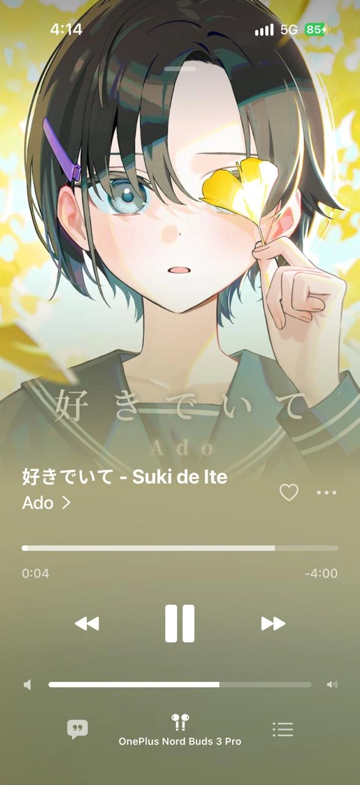
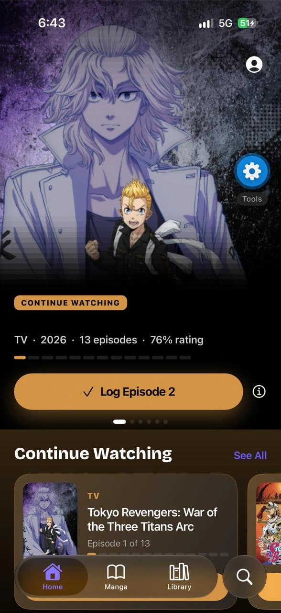
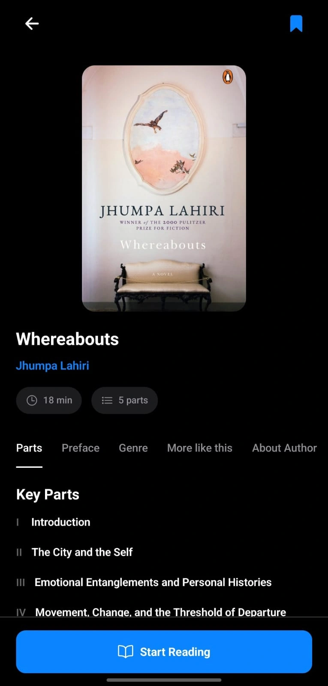
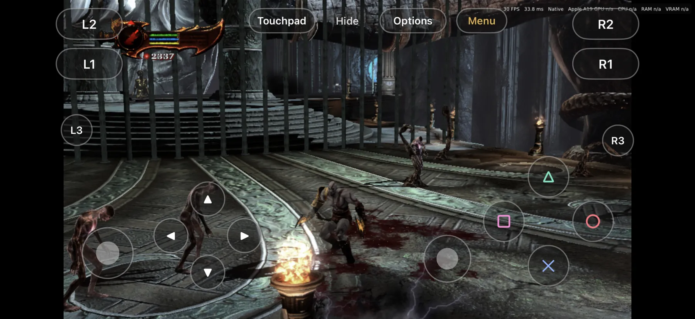

 

 

## 🎙️ At work: AI that answers the phone and reads the paperwork

I build a **real-time voice agent** that books and cancels appointments through tool calls, with a **check-before-write guard** that confirms every write with the caller first. I also work on an **intelligent document processing** pipeline that digitizes scans while keeping their layout, pulling from Drive and Gmail and posting to Sheets and Tally.

<table>
  <tr>
    <td align="center" valign="top" width="25%"><h1>223</h1>test calls handled end to end</td>
    <td align="center" valign="top" width="25%"><h1>106</h1>bookings completed by voice</td>
    <td align="center" valign="top" width="25%"><h1>1,497</h1>tool calls made</td>
    <td align="center" valign="top" width="25%"><h1>16k+</h1>documents processed a month</td>
  </tr>
</table>

## 📱 Apps I shipped, iOS and Android

<table>
  <tr>
    <td align="center" valign="top" width="33%">
       
      <h3>Tactus</h3>
      Music streaming with synced karaoke lyrics and translation, offline downloads and a liquid-glass UI.  
      <code>React Native</code> <code>Expo</code> <code>Supabase</code>
    </td>
    <td align="center" valign="top" width="33%">
       
      <h3>Tsuzuku 続く</h3>
      Anime, manga and manhwa tracker that pings you the moment a new episode or chapter drops.  
      <code>Expo</code> <code>Jikan API</code> <code>Expo Notifications</code>
    </td>
    <td align="center" valign="top" width="33%">
       
      <h3><a href="https://github.com/MohinShaikh5689/Readverse-mobile-app">ReadVerse</a></h3>
      Multilingual reading app for books, manga and manhwa, with its own <a href="https://github.com/MohinShaikh5689/Read-Verse-backend">API</a> and admin panel.  
      <code>React Native</code> <code>Fastify</code> <code>Prisma</code>
    </td>
  </tr>
</table>

## 🎮 God of War III, running natively on an iPhone

**[Project Olympus](https://github.com/MohinShaikh5689/god-of-war-3-ios)** is a native iOS port of the PS4 game, not an emulator. The game's x86-64 code is translated to ARM64 at runtime by FEXCore, a custom runtime replaces the PS4 system libraries, and shadPS4's renderer runs Vulkan on Metal. It hits about **30 FPS on an iPhone 17**, sideloaded, no jailbreak.

## 🧪 Also building

| Project | What it does |
| --- | --- |
| 🤖 **[Mobile Agent](https://github.com/MohinShaikh5689/Mobile-Agent)** · *in development* | A personal agent built to run entirely on the phone with a local llama.cpp model and LangGraph.js, answering across Gmail, Drive and Calendar, with approval cards before any write. |
| 🎫 **[Aegis Support Hub](https://github.com/MohinShaikh5689/ticket-frontend)** | Support tickets triaged by Gemini, with an AI copilot panel. Fastify + Prisma + Supabase [API](https://github.com/MohinShaikh5689/ticket-backend). |
| 🕹️ **Nexus Game Launcher** | Native desktop launcher with achievements, a Big Picture mode and cloud backup. Tauri + React. |

## 🛠️ Tools I use

   
  

<b>AI & voice:</b> LangChain · LangGraph · OpenAI SDK · Gemini · Pipecat · Silero VAD · Soniox · ElevenLabs &nbsp;|&nbsp; <b>Mobile:</b> React Native · Expo · Tauri

 

  
    
  BSc IT, Somaiya Vidyavihar University · Previously Full-Stack Developer Intern at Nosis (UAE)

